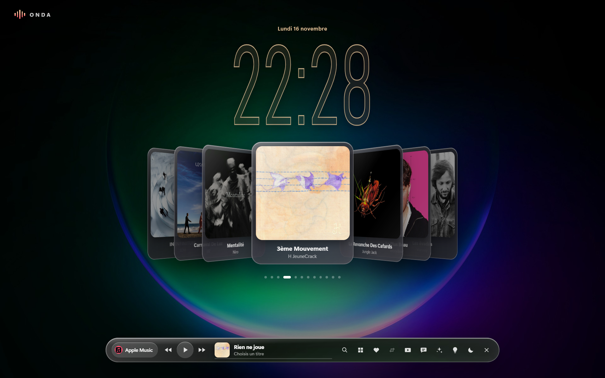
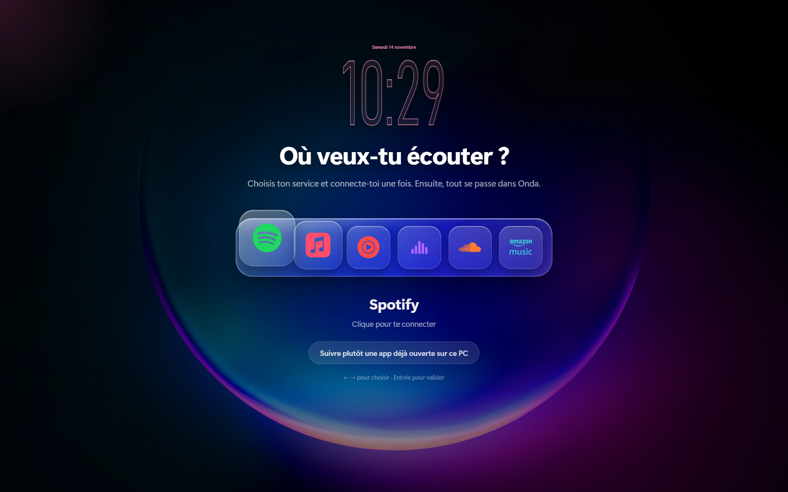

<div align="center">


# Onda

### La musique en grand.

Le clip en plein écran, les paroles qui s'allument mot par mot,<br>
ta bibliothèque, et une lumière qui bat au rythme du son.

[](../../releases/latest)
[](../../releases)

[](../../stargazers)

### [⬇ Télécharger Onda](../../releases/latest)

⭐ **Onda te plaît ? Laisse une étoile (bouton « Star » en haut à droite).**<br>
C'est gratuit, ça prend une seconde, et c'est ce qui fait connaître le projet.

</div>



---

## Sommaire

- [Ce que fait Onda](#ce-que-fait-onda)
- [D'où vient le son](#doù-vient-le-son)
- [Installer Onda](#installer-onda)
- [Premiers pas](#premiers-pas)
- [Raccourcis clavier](#raccourcis-clavier)
- [Questions fréquentes](#questions-fréquentes)
- [Vie privée](#vie-privée)
- [Compiler Onda soi-même](#compiler-onda-soi-même)
- [Licence](#licence)

---

## Ce que fait Onda

**🎬 Le clip en fond d'écran**<br>
Quand un titre joue, son clip officiel (Onda choisit en priorité le plus vu, sur la chaîne de l'artiste) remplit tout l'écran, dans une définition adaptée à ton écran et à ta connexion. Pas de logo YouTube, pas de suggestions en fin de clip : le grand logo Onda prend le relais entre deux titres.

**🎤 Les paroles façon karaoké**<br>
Les paroles synchronisées s'affichent en grand et s'allument mot par mot. Rien ne s'affiche tant que le chant n'a pas commencé. Si une chanson est décalée, les touches `-` et `+` la recalent, et Onda s'en souvient.

**📚 Ta bibliothèque**<br>
Connecte ton compte une fois : Onda affiche tes ajouts récents, tes écoutes, ta musique et tes playlists (Apple Music, Spotify, YouTube Music). La bibliothèque est gardée en mémoire et s'affiche tout de suite au lancement suivant.

**▶ Un clic, ça joue**<br>
Clique sur un titre, il part. Clic droit pour le lire juste après, l'ajouter à la fin de la file ou le mettre en favori. La liste de droite montre ce qui va suivre, et se pilote aussi au clavier.

**🌙 Deux modes veille**
- **Clip et heure** : juste le clip et une grande horloge.
- **Paroles** : un « edit » en temps réel où les paroles s'animent en grand, avec un style différent pour chaque chanson.

**✨ L'ambiance**
- Une lumière sur les bords de l'écran qui bat au rythme de la musique, avec des étincelles.
- Les couleurs de la pochette reprises dans toute l'interface.
- Un effet de profondeur 3D qui suit ta souris, ou ta tête si tu as une webcam (seulement sur les PC assez puissants).
- Un mode allégé automatique pour les PC plus modestes.

**🔄 Les mises à jour automatiques**<br>
Quand une nouvelle version sort, Onda te la propose : un clic, il s'installe et se relance.



---

## D'où vient le son

Onda essaie toujours de jouer le son **sur ta plateforme**, dans son lecteur intégré et caché, là où tu es connecté. Aucune autre application ne s'ouvre. Le clip YouTube reste alors à l'image, sans son, et les paroles suivent la position de ta plateforme.

| Service | Windows | Mac | Linux |
|---|:---:|:---:|:---:|
| Spotify (Premium ou gratuit) | ✅ | ✅ | ❌ |
| Apple Music | ✅ | ✅ | ❌ |
| Deezer | ✅ | ✅ | ✅ |
| SoundCloud | ✅ | ✅ | ✅ |
| YouTube Music | ✅ | ✅ | ✅ |
| Amazon Music | ❌ | ❌ | ❌ |

**Quand c'est ❌**, la plateforme refuse de jouer dans une autre application (protections anti-copie absentes du moteur web de Linux, ou aucun moyen pour Amazon Music). Le son vient alors du **clip officiel** sur YouTube, Onda te le signale, et des publicités YouTube peuvent apparaître sur certains titres.

> Cette lecture sur ta plateforme est récente et encore peu testée avec de vrais comptes. Si un service ne joue pas, dis-le dans l'onglet [**Issues**](../../issues).

---

## Installer Onda

Va sur la [page des téléchargements](../../releases/latest) et prends le fichier de ton système.

### 🪟 Windows

1. Télécharge **`Onda_…_x64-setup.exe`** et ouvre-le.
2. Windows peut afficher « Windows a protégé votre ordinateur » : c'est normal pour une application sans certificat payant. Clique sur **Informations complémentaires**, puis **Exécuter quand même**.
3. L'installation se fait en quelques secondes, sans droits administrateur. Onda apparaît dans le menu Démarrer.

### 🍎 Mac

1. Télécharge **`Onda_…_universal.dmg`** (Mac Apple et Intel) et ouvre-le.
2. Glisse **Onda** dans le dossier **Applications**.
3. Au premier lancement, macOS peut dire que l'app « provient d'un développeur non identifié » : fais un **clic droit sur Onda → Ouvrir**, puis confirme. Si macOS dit que l'app est « endommagée », ouvre le Terminal et tape :
   ```
   xattr -cr /Applications/Onda.app
   ```

### 🐧 Linux

- **Toutes les distributions** : télécharge **`Onda_…_amd64.AppImage`**, rends-le exécutable puis lance-le :
  ```
  chmod +x Onda_*.AppImage
  ./Onda_*.AppImage
  ```
- **Debian / Ubuntu** : télécharge le **`.deb`** et installe-le (les codecs vidéo nécessaires sont installés avec) :
  ```
  sudo apt install ./Onda_*.deb
  ```

---

## Premiers pas

1. Au premier lancement, choisis ton service de musique.
2. Connecte-toi dans la fenêtre qui s'ouvre, puis clique **Terminé**. La connexion se fait sur la page officielle du service : Onda ne voit jamais ton mot de passe.
3. Ta bibliothèque arrive. Clique sur un titre : il se lance avec son clip et ses paroles.

Le bouton **⋯** de la barre du bas ouvre les options : répétition, clip, étincelles, lumière, les deux modes veille, l'effet 3D, plein écran ou fenêtre.

---

## Raccourcis clavier

| Touche | Action |
|---|---|
| `Espace` | Lecture / pause |
| `←` `→` | Parcourir les pochettes |
| `↑` `↓` | Se déplacer dans la liste de droite |
| `Entrée` | Lancer le titre sélectionné |
| `M` | Ouvrir le menu du titre (juste après, à la fin, favori) |
| `-` `+` | Avancer ou retarder les paroles |
| `F11` | Plein écran / fenêtre |
| `Échap` | Revenir en arrière ou masquer Onda |
| Touches multimédia du clavier | Lecture / pause, suivant, précédent |

---

## Questions fréquentes

<details>
<summary><b>Onda reste bloqué sur l'intro, ou ne se met pas à jour</b></summary>

Jusqu'à la version 1.0.18, la mise à jour automatique sous Windows pouvait échouer (sans rien dire, ou avec le message « Impossible de trouver '\\' »). C'est corrigé depuis la 1.0.19, mais une version plus ancienne ne peut pas se réparer seule : **télécharge une fois l'installateur** sur la [page des téléchargements](../../releases/latest) et lance-le. Ta bibliothèque et tes réglages sont conservés.
</details>

<details>
<summary><b>Pourquoi j'entends des publicités ?</b></summary>

Seulement quand le son vient du clip YouTube, c'est-à-dire quand ta plateforme ne peut pas jouer dans Onda (voir le tableau plus haut). Quand le son vient de ta plateforme, le clip est muet.
</details>

<details>
<summary><b>Les paroles sont décalées</b></summary>

Appuie sur `-` (paroles plus tôt) ou `+` (paroles plus tard), par pas d'une demi-seconde. Onda retient ce réglage pour chaque chanson. Les paroles viennent de [LRCLIB](https://lrclib.net) : certains titres n'en ont pas.
</details>

<details>
<summary><b>Ma bibliothèque n'apparaît pas</b></summary>

Apple Music est la plus testée. Spotify et YouTube Music sont prises en charge mais moins testées. Pour Deezer, SoundCloud et Amazon Music, utilise la recherche. Si rien n'arrive, signale-le dans l'onglet [**Issues**](../../issues).
</details>

<details>
<summary><b>Onda marche-t-il sur Mac et Linux ?</b></summary>

Les versions Mac et Linux sont fabriquées automatiquement à partir du même code, mais elles n'ont pas encore été essayées par de vrais utilisateurs : Onda est surtout utilisé sous Windows. Tout retour est bienvenu dans l'onglet [**Issues**](../../issues). La version `.deb` ne se met pas à jour toute seule : préfère l'AppImage, ou retélécharge le `.deb`.
</details>

---

## Vie privée

- **Aucun mot de passe** ne passe par Onda : tu te connectes sur la page officielle de ton service.
- **Tout reste sur ton ordinateur** : ta bibliothèque, tes favoris et tes réglages ne sont envoyés nulle part. Onda n'a ni compte, ni statistiques, ni pistage.
- **La webcam** (effet 3D, désactivé par défaut) sert seulement à repérer la position de ton visage, image par image, sur ton ordinateur. Rien n'est enregistré ni envoyé.

---

## Compiler Onda soi-même

Il faut [Rust](https://rustup.rs) et [Node.js](https://nodejs.org), plus les [prérequis Tauri](https://tauri.app/start/prerequisites/) de ton système.

```
npm install
npm run tauri build
```

Les installateurs sont créés dans `src-tauri/target/release/bundle/`.

Onda est faite avec [Tauri](https://tauri.app) (Rust) : l'application est légère et démarre vite, sans embarquer de navigateur complet.

---

## Licence

Onda est **gratuite et son code est visible**, mais ce n'est pas un logiciel libre : tu peux l'utiliser et lire son code, mais pas la revendre, la redistribuer modifiée ni réutiliser son code ailleurs sans accord. Tout est expliqué dans [LICENSE](LICENSE).

Onda n'est ni affiliée ni approuvée par Apple, Spotify, YouTube, Deezer, SoundCloud ou Amazon. Leurs noms et logos appartiennent à leurs propriétaires.

---

<div align="center">


**Tu aimes Onda ?** ⭐ [Une étoile sur GitHub](../../stargazers), c'est le meilleur moyen de soutenir le projet.

</div>
